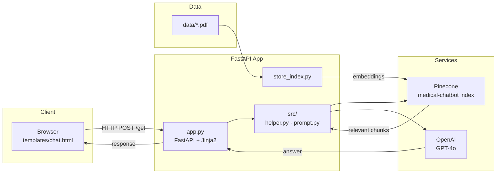

# End-to-End Medical Chatbot

A production-oriented medical question-answering chatbot built with **FastAPI**, **LangChain**, **Pinecone**, and **OpenAI**.  
It uses Retrieval-Augmented Generation (RAG) over medical PDFs to give concise, context-grounded answers.

## Architecture



## Tech Stack

- **Backend**: FastAPI + Uvicorn
- **RAG**: LangChain
- **Vector DB**: Pinecone (serverless)
- **Embeddings**: `sentence-transformers/all-MiniLM-L6-v2`
- **LLM**: OpenAI `gpt-4o`
- **Frontend**: Jinja2 templates + Bootstrap

## Project Structure

```
End-to-End-Medical-Chatbot/
├── src/
│   ├── helper.py          # PDF loading, chunking, embeddings
│   └── prompt.py          # System prompt
├── templates/
│   └── chat.html          # Chat UI
├── static/
│   └── style.css
├── data/                  # Place medical PDFs here
├── app.py                 # FastAPI application
├── store_index.py         # One-time indexing script
├── requirements.txt
├── setup.py
├── .env.example
└── README.md
```

## Setup

### 1. Clone & environment
```bash
git clone https://github.com/yash9614/End-to-End-Medical-Chatbot.git
cd End-to-End-Medical-Chatbot
```

Use an existing uv/conda/venv environment or create one:
```bash
python -m venv .venv
source .venv/bin/activate   # Windows: .venv\Scripts\activate
```

### 2. Install dependencies
```bash
pip install -r requirements.txt
pip install -e .
```

### 3. Environment variables
Create a `.env` file in the root (or copy from `.env.example`):

```ini
PINECONE_API_KEY=your_pinecone_api_key
OPENAI_API_KEY=your_openai_api_key
```

### 4. Index the medical documents
Place one or more PDFs inside the `data/` folder, then run:
```bash
python store_index.py
```

### 5. Run the application
```bash
python app.py
```

Open [http://localhost:8080](http://localhost:8080)

## API Endpoints

| Method | Endpoint | Description |
|--------|----------|-------------|
| GET    | `/`      | Chat UI     |
| POST   | `/get`   | Chat endpoint (form field: `msg`) |

## Deployment Notes

- Docker + GitHub Actions CI/CD ready (see `.github/workflows/`)
- Can be deployed to AWS ECS/EC2, Railway, Render, or any container platform
- Remember to set the same environment variables in the deployment environment

## License

MIT
